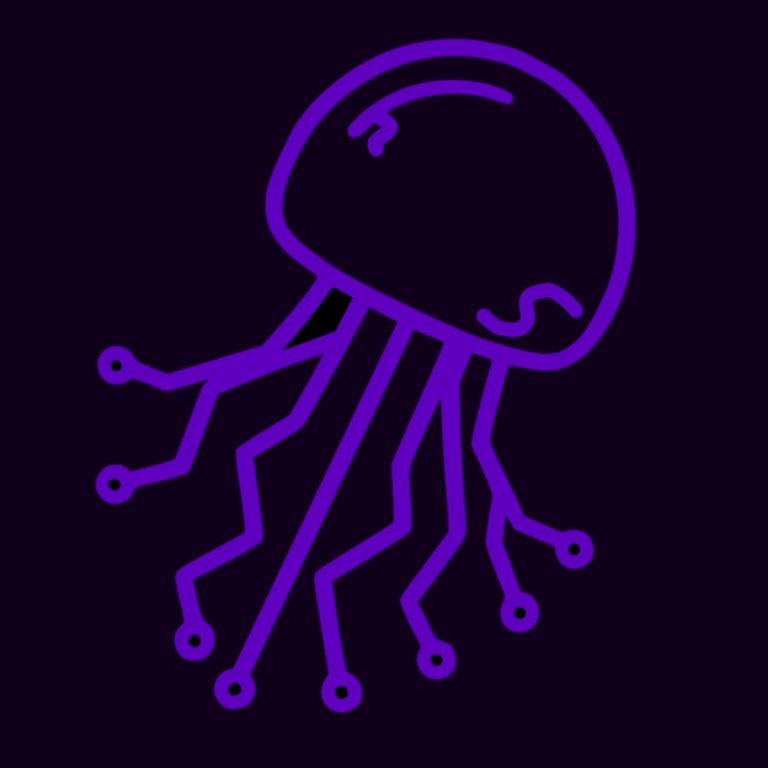

<div align="center">

  

  # nyx.loader
  ### *The definitive cosmic companion for iOS sideloading*

  [](https://github.com/NyxSile/nyx.loader/actions)
  [](https://github.com/NyxSile/nyx.loader/releases)
  [](https://github.com/NyxSile/nyx.loader/releases)
  [](LICENSE)

  <br />

  **[🌐 Ecosystem Portal](https://nyx.sideload.space)** • **[👾 Developer](https://nyxsile.lol)** • **[📦 Releases](https://github.com/NyxSile/nyx.loader/releases)**

</div>

---

## 🌌 Overview

**nyx.loader** (`n1.0.0`) is the modern, ultra-fast desktop companion for the **nyx.sideload** ecosystem. Engineered with **Tauri v2**, **Rust**, and **React 19**, it delivers an uncompromising sideloading workflow: painless pairing file extraction and automatic delivery right onto your iOS device, instant drag-and-drop IPA installation, and 1-click SideStore & LiveContainer deployment.

Designed from the ground up with deep cosmic glassmorphism, dynamic interactive particle fields, and lightning-fast native performance.

---

## ✨ Features

- ⚡ **Direct iOS Files Pairing Delivery**: Automatically deposits `ALTPairingFile.mobiledevicepairing` and pairing plists directly into your iPhone's storage and app containers. Open the **Files** app on iOS (`On My iPhone` ➔ `SideStore`), and your pairing file is already there!
- 📦 **Drag & Drop IPA**: Drop any `.ipa` file directly onto the cosmic workspace window to trigger instant code signing and installation.
- 🚀 **1-Click SideStore & LiveContainer**:
  - SideStore (Stable & Nightly)
  - LiveContainer + SideStore combo (Stable & Nightly)
  - Automatic certificate creation, provisioning profile installation, and pairing injection.
- 🌌 **Cosmic Glassmorphism & Simple Mode**:
  - Immersive neon glass aesthetics with interactive stars canvas.
  - Dedicated **Simple Mode** toggle for lightweight, zero-blur execution on low-end PCs.
- 📋 **Device Management & UDID**:
  - Live connection badges (**USB** / **Wi-Fi**).
  - 1-click **Copy UDID** button for quick developer portal registrations.
- 🛡️ **Apple ID & Certificates**:
  - Sign in safely with Apple ID (native secure keychain or direct memory session).
  - View, inspect, and revoke development certificates and App IDs directly inside the app.
  - Custom Anisette server selection with zero lock-in.
- 🩺 **1-Click Diagnostic Copy**:
  - Instant full environment diagnostic dump to clipboard for effortless troubleshooting.

---

## 📥 Download & Installation

Get the latest binary for your operating system from the **[Releases Page](https://github.com/NyxSile/nyx.loader/releases)**:

### 🍏 macOS (Universal: Apple Silicon M1-M4 & Intel)
1. Download `nyx.loader-macos-universal.dmg`.
2. Open the `.dmg` and drag **nyx.loader** to your `Applications` folder.
3. *Note:* Ensure you have connected your iOS device and selected **Trust this computer** on your device screen.

### 🪟 Windows (x64)
1. Install [iTunes for Windows (Direct from Apple)](https://apple.co/ms) to ensure Apple USB drivers (`usbmuxd`) are installed.
2. Download `nyx.loader-windows-x86_64.exe` from Releases.
3. Run the installer and launch **nyx.loader**.

### 🐧 Linux (Debian, Ubuntu, Fedora, Arch & ARM64)
- **AppImage**: Download `nyx.loader-linux-x86_64.AppImage` (or `arm64`), make executable (`chmod +x nyx.loader*.AppImage`), and run!
- **Debian / Ubuntu**: `sudo dpkg -i nyx.loader-linux-x86_64.deb`
- **RPM (Fedora / RHEL)**: `sudo rpm -i nyx.loader-linux-x86_64.rpm`
- Make sure `usbmuxd` is active: `sudo systemctl start usbmuxd`.

---

## 🚀 Quick Start

```text
 1. Connect your iPhone or iPad to your computer via USB (or Wi-Fi).
 2. Open nyx.loader and sign into your Apple ID.
 3. Click on your device in the DEVICES list.
 4. Click "SideStore (Stable)" or drop your favorite .ipa onto the window!
 5. nyx.loader handles pairing, certificates, and installation automatically.
```

---

## 🛠️ Building from Source

### Prerequisites
- [Node.js](https://nodejs.org) (v20+) or [Bun](https://bun.sh)
- [Rust](https://www.rust-lang.org/tools/install) (1.78+)
- Platform native build dependencies:
  - **macOS**: Xcode Command Line Tools (`xcode-select --install`)
  - **Linux**: `libwebkit2gtk-4.1-dev`, `libappindicator3-dev`, `librsvg2-dev`, `patchelf`
  - **Windows**: Visual Studio C++ Build Tools

### Clone & Build

```bash
# Clone the repository
git clone https://github.com/NyxSile/nyx.loader.git
cd nyx.loader

# Install dependencies
npm install  # or bun install

# Run frontend in development mode with HMR
npm run dev

# Run desktop app in development mode
npm run tauri dev

# Build production bundle for your platform
npm run tauri build
```

---

## ⚖️ Disclaimer

> [!NOTE]
> *«Я, NyxSile, не перенимаю права, и уважительно отношусь ко всем дистрибуциям и импактам сделанными разработчиками iLoader-а, SideStore, и LiveContainer в мир сайдлоудинга на iOS.»*
>
> nyx.loader is an independent companion application created for enthusiasts within the sideloading ecosystem. Apple, iPhone, iPad, iOS, macOS, and iTunes are trademarks of Apple Inc. nyx.loader is not affiliated with, endorsed by, or sponsored by Apple Inc.

---

## 💜 Credits & Acknowledgements

- **Original Base**: [iloader](https://github.com/nab138/iloader) by [nab138](https://github.com/nab138).
- **Device Communication**: [idevice](https://github.com/jkcoxson/idevice) by [jkcoxson](https://github.com/jkcoxson).
- **App Installation & Sideloading**: [isideload](https://github.com/nab138/isideload).
- **Codesigning**: [apple-codesign-quick](https://github.com/Dadoum/apple-codesign-quick) & [Sideloader](https://github.com/Dadoum/Sideloader) by [Dadoum](https://github.com/Dadoum).
- **Pairing Protocols**: [idevice_pair](https://github.com/jkcoxson/idevice_pair).
- **Ecosystem**: [nyx.sideload](https://nyx.sideload.space) by **NyxSile**.
- Built with [Tauri v2](https://tauri.app) & [React](https://react.dev).

---

<div align="center">
  <sub>Crafted with 💜 for the sideloading community by <a href="https://nyxsile.lol">NyxSile</a>.</sub>
</div>
